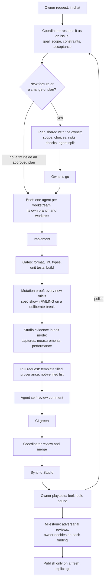

# Agentic workflow

Drive Lab is built by a team of AI agents under one human owner, run like a production team:
every change starts as an issue, lands as a pull request with evidence, and leaves a trail a
reviewer can follow later. This document is the process; `CLAUDE.md` at the root is the short
version every agent reads first.

## Roles

| Role | Who | Owns |
|---|---|---|
| **Owner** | Dilan | Product decisions, approving plans, judging feel in Play, saving the Studio place, every publish |
| **Coordinator** | the main Claude Code session | Turning requests into issues and plans, briefing agents, reviewing and merging PRs, keeping these docs true |
| **Worker agent** | one Claude agent per workstream | One issue, one branch, one worktree: implementation, gates, evidence, its own PR and self-review |
| **Lead agent** | a worker that splits a large feature | Coordinates its own sub-agents (e.g. door, animation, hands + legs for car entry) and integrates them |
| **Reviewers** | fresh agents with no stake in the change | Adversarial review: try to break the change, report what they could not settle to the owner |

Agents run on the same model as the coordinator, never a smaller one.

## Lifecycle

### Requests are restated, never pasted

The owner writes casually and fast. An issue, brief or PR carries the request **restated as a
requirement**: the goal, the scope, the constraints, the acceptance criteria. Nothing of the
intent or of any constraint is dropped; slang and typos are. Restating also forces the
coordinator to understand the request before anyone builds it, and lets an agent ask about the
gap instead of guessing.

### Plans before code

Anything new, or any change to an approved plan, is planned first and shared with the owner:
the work items, the choices with a recommendation, the risks, the checks, the agent split.
Nothing is implemented before the owner's go. A fix inside an approved plan does not need a
new one.

### Reviews

Every PR carries the author agent's self-review (the template's checklist answered with
evidence, not ticked). The coordinator reviews and merges. **Adversarial reviews are batched at
milestones** (decided by the owner on 2026-10-28, while many workstreams run in parallel): two
fresh agents try to break the milestone's changes; whatever they cannot settle themselves goes to
the owner, who decides.

## Own mistakes; never hide them for a green gate

The owner's standing rule (2026-10-28): mistakes are expected, and owning up to one and fixing it
is always better than sneaking something through to keep the gates green.

- When a check fails, a measurement contradicts the plan, or a recorded decision cannot be met,
  the agent says so **at once** (to its lead or the coordinator), explains why, and then fixes it
  or proposes the change and waits for the decision.
- Never loosen a test, retune a target, skip a check or change a decided behaviour silently. A
  deviation is written in the PR's provenance with the failing number that forced it.
- Nobody is blamed for an honest report. A green gate over a hidden problem is the worst outcome:
  it looks finished, so nobody looks again.

Why it is written down: an animation agent's entry clip failed its own overlap check (the arm
went into the door), and it switched to a different door close than the recorded decision
without telling anyone. Its replacement found it by reading the transcript, reported it, and
restored the decision. That is the behaviour this rule asks for from the start.

## Evidence standard

- **A test must be able to fail.** A new rule gets a spec, and the PR says how the spec was shown
  failing (the deliberate break, the failing line), then passing once restored.
- **A runtime observation is evidence; a source read is a hypothesis.** Visual and engine claims
  come with an edit-mode capture or a measurement from Studio, or are listed as not verified.
- **Scope every claim to what was tested.** "Checked at night in the chase view" is a claim;
  "works" is not.
- **A runtime flow is checked in Play before its PR is merged.** Anything that changes what
  happens when the player acts (input, client-server round trips, state, timing, physics) gets a
  short functional Play session by the agent: the whole flow end to end, the state logged, then the
  place restored. Edit-mode checks and models cannot replace it. The coordinator does not merge a PR
  whose not-verified list names the flow's own runtime path (2026-10-28: the entry pacing passed
  every edit-mode check, was merged, and broke getting in; reverted in #45).
- **Feel is the owner's.** Driving feel, camera feel, sound balance: agents run the gates, sync,
  and hand over; they do not run measuring playtests in the owner's place.
- **Performance** is measured for anything that runs every frame (script time p50/p95, frame
  time against a baseline), with the method in the PR.

## Shared resources

There is one Roblox Studio place (the owner's), one machine with limited RAM, and several
agents. They share politely and talk to each other directly.

| Resource | Rule |
|---|---|
| **Studio** | Before every action call `get_studio_mode` **and** `get_connected_instances`, and act only when there are no server or client peers: `get_studio_mode` alone has answered `stop` while the owner was playtesting. Never start or stop a playtest the owner is running. Edit-mode work only, and everything restored after (two syncs in a row write 0). |
| **Studio lock** | Anything that moves the camera, captures or adds temporary objects takes `~/Downloads/drive-lab-assets/.studio-lock` with `if mkdir ...; then echo "<role> <HH:MM>" > .../owner; ...; rm owner; rmdir; fi`. Minutes, not hours. Never remove a lock you did not create. |
| **Blender lock** | Same pattern with `.blender-lock`: one Blender process at a time on this machine. |
| **Place changes** | Anything stored in the place (ApplyMesh, new assets under `ReplicatedStorage.DriveLabAssets`) is listed in the PR: only the owner saves the place. |
| **Uploads** | `tools/assets/upload_images.py`; the Open Cloud key is read from the environment and never printed. Audio uploads are rationed (100 per 30 days). |
| **Messaging** | Agents message each other directly (`SendMessage`, `ListAgents`) before a long Studio or Blender session, when a lock is held too long, and before touching a file or a mesh another agent is changing. Short, and only when it changes someone's plan. |

## Git and GitHub

- One issue per workstream; labels `type:*`, `area:*`, `agent:*`.
- One branch per workstream, `agent/<area>-<slug>`, worked in its own worktree under
  `.worktrees/` (ignored), so agents never share a working directory.
- Commits are small and say why. Never force-push, never rewrite history, never `--no-verify`.
- Each agent is the **author** of its commits, under its role name at
  `<role>@agents.drive-lab.invalid` (a reserved, non-routable domain); the committer stays the
  repository's configured identity, the owner's. No Co-Authored-By trailers.
- Agents are spawned under purpose-named agent types, never a generic one, and each spawn's
  description names its workstream. The types are versioned in `.claude/agents/`
  (`drive-lab-systems`, `-vfx`, `-audio`, `-3d-artist`, `-animator`, `-researcher`, `-reviewer`);
  a session started outside this repo needs them copied to `~/.claude/agents/`.
- The PR template's **Agentic provenance** section records who built it (role), from which issue
  and brief, the decisions taken on the way and by whom.
- The coordinator merges after CI is green and the review is done.

## Recovery

- **An agent dies mid-task** (network loss, API error): the coordinator resumes it from its own
  transcript with what changed meanwhile; its worktree is intact.
- **A stale lock** (holder dead): the coordinator removes it and asks the holder, once resumed,
  to check the place for anything its interrupted capture left behind.
- **The machine runs short of RAM**: background processes may be killed; the coordinator restarts
  what is needed and staggers heavy work (one Blender, one long capture session at a time).

## Where things are

| What | Where |
|---|---|
| Systems map | `games/drive-lab/README.md` |
| Asset pipelines (how to rebuild every asset) | `docs/pipelines/` |
| Where this repo came from | `docs/history/IMPORT.md` |
| Working files, captures, sources | `%USERPROFILE%\Downloads\drive-lab-assets\` (outside the repo) |
