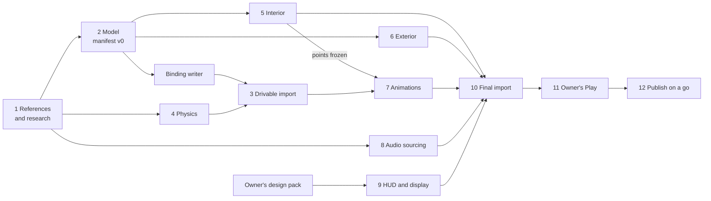

# New car playbook: adding car 3

The master runbook for adding a car to Drive Lab, from choosing it to the publish. It puts every
stage in order with a gate, says who does what with which tools, what to reuse from the SVJ and
the DR458, when the owner decides, and what each stage cost last time.

Why it exists: the SVJ and then the DR458 (Ferrari 458 Challenge Evo) each took many hours across
modelling, interior accuracy, animation, audio, the HUD and wiring. The owner asked for the process
to be written down and generalised so that many more cars can be made faster and cheaper
(2026-10-30), and for car 3 to start ready, without the hours the DR458's model, interior and
animations took (2026-10-31).

Two specialist playbooks carry the detail. This page links to them and does not repeat them:

- [MODELLING.md](MODELLING.md): the model and its interior
  ([order of work](MODELLING.md#order-of-work), [checks](MODELLING.md#checks),
  [time](MODELLING.md#time), [pitfalls](MODELLING.md#pitfalls)).
- [ANIMATION.md](ANIMATION.md): the driver's animations
  ([step by step](ANIMATION.md#a-new-car-step-by-step),
  [what the model must give](ANIMATION.md#inputs-the-model-must-give), [time](ANIMATION.md#time),
  [pitfalls](ANIMATION.md#pitfalls)).

## How to read it

| Tag | Meaning |
|---|---|
| **[M]** | measured: a PR or commit timestamp, a clock time an agent read, a check's output |
| **[J]** | judgement: a recommendation, not a measurement |
| **[O]** | the owner's decision |
| **[S]** | stated by a doc or a file header, not re-measured here |

Sources: `#n` is an issue or PR in this repository. `notes:<topic>` is an agent's running note,
`drive-lab-assets/dr458/work/NOTES_<topic>.md`, kept outside the repository (ask the
coordinator). `handoff` is the coordinator's log `drive-lab-assets/COORDINATOR_HANDOFF.md`.
`brief` is `drive-lab-assets/BRIEF_COMMON_2026-10-31.md`. `owner-note` is the owner's own
working notes. Clock times are Paris time (UTC+1); `Z` marks UTC.

**Clock warning.** The handoff's overnight "about HH:MM" times run 2.5 to 3.5 hours ahead of the
real clock (#138 merged at 01:21Z, 02:21 Paris; the handoff says "about 04:45"). One animator's
note headings also used a wrong clock. Every time below is a PR or commit timestamp or a note's
clock time checked against one. [M]

## Contents

- [The run at a glance](#the-run-at-a-glance)
- [Before car 3: get ready](#before-car-3-get-ready)
- [The stages](#the-stages), 1 to 12
- [Time budget](#time-budget)
- [Parallelism, Studio and merging](#parallelism-studio-and-merging)
- [Top pitfalls](#top-pitfalls)

## The run at a glance

| # | Stage | Who | Gate to move on |
|---|---|---|---|
| 1 | Choose the car, gather references | owner, researcher | research note with confidence tags; named photo set; the bar written down |
| 2 | Source and assemble the model | 3D artist | manifest v0 checklist met; export dry run passes |
| 3 | Drivable-first import | systems agent, coordinator | the car drives in Play beside the SVJ, SVJ unchanged |
| 4 | Per-car contract entries | systems, audio, VFX, animator | `Contract.define` loads the car; gates green; SVJ byte-identical |
| 5 | Interior accuracy | 3D cockpit and polish artists | eye checks pass; the points animation needs are frozen |
| 6 | Exterior | 3D materials artist | materials apply with 0 missing; lamps are the first surface seen |
| 7 | Animations | animators | every clip passes the per-group check on its Blender bake |
| 8 | Audio sourcing and owner picks | audio agent | the owner picked from phone previews; regions spec green |
| 9 | HUD and display | systems agent | HUD and display specs green; SVJ fixture identical |
| 10 | Final import | coordinator (systems agent prepares) | build report as expected; two syncs, the second writes 0 |
| 11 | Owner's Play | owner | no bugs or regressions; feedback restated as issues |
| 12 | Publish | coordinator, on the owner's go | the owner confirms in game |

Stages 2, 4, 8 and 9 start together. Stage 3 comes as early as the model allows, so nothing waits
for accuracy (see [Parallelism](#parallelism-studio-and-merging)).

## Before car 3: get ready

The DR458 paid for these lessons once. Doing them before car 3 starts is the biggest saving. [J]

1. **Put the DR458's assembly, export and import scripts in the repository.** They live only in
   `drive-lab-assets/dr458/work/` today: `assembly/assemble_preview.py`, `assembly/export_dr458.py`,
   the Blender runner, `import/studio/build_import_data.py` and the Studio build script. The
   first import's Studio script was never saved as a file and had to be recovered from a
   transcript (notes:import, second import 04:01). Make them car-agnostic with a per-car settings
   file, as the binding's pure half already is. The animators' scratch scripts are in the same
   state; [ANIMATION.md](ANIMATION.md#time) lists the ones to promote into `tools/anim`.
2. **Make the binding writer generic.** In `games/drive-lab/tools/`, `ManifestBinding.luau` is
   pure and shared, while `dr458_binding.luau` hard-codes the DR458's paths and
   `DR458Binding.luau` holds its settings. Car 3 needs its own pair, or one writer that takes the
   car's name.
3. **Agree the manifest checklist with the 3D artist before modelling** (the list in
   [stage 2](#2-source-and-assemble-the-model)). On the DR458 the binding owner had to ask the 3D
   lead, the cockpit modeller and the audio agent for missing fields while writing the writer
   (notes:systems).
4. **Know the door type when the car is chosen.** The DR458's entry over its cage took about 13
   agent-hours (ANIMATION.md#time). A car whose door and cabin are like one already done (the
   SVJ's scissor door over a wide sill, the DR458's front-hinged door into a cage) starts from that
   car's keys; a door type not done before (gullwing, butterfly) adds an estimated 2-3 h to the
   entry (ANIMATION.md#time). Tell the owner when the car is chosen. [J]
5. **Brief from the common brief.** `brief` carries every rule an agent needs (read first, plan to
   the coordinator, gates, Studio, memory, notes); start car 3's brief from it.
6. **Keep notes with real clock times.** Each agent keeps `NOTES_<topic>.md` with the time each
   step took, read with `date`, never estimated (notes:audio_round2 corrected a line of estimated
   times).

## The stages

Each stage lists: **who**, **in** (inputs), **do** (tools and commands), **gate**, **reuse**,
**owner** (what the owner decides and how to show it) and **uploads**. Every upload goes through
the coordinator with the owner's approval; the Open Cloud key is read from the environment and
never printed (`tools/assets/upload_images.py` header).

### 1. Choose the car and gather references

- **Who:** the owner chooses; a researcher agent (web search and fetch only); the coordinator
  opens the issue and sends the plan.
- **In:** the owner's pick and the bar.
- **Do:**
  - Restate the request as an issue and share a plan before any work
    (`docs/engineering/AGENTIC_WORKFLOW.md`, "Plans before code").
  - Write `docs/research/<nn>_<car>.md` the way `12_dr458_challenge_evo.md` is written: every value
    tagged documented, likely, unknown or inferred, every photo named, and the corrections the
    photos make to the brief. Research 12 found, for example, that LEFT and RIGHT are the turn
    signals, not display pages, and that the wheel has no screen (its "Corrections to the brief").
  - Collect the reference photos in one named folder (exterior, interior, mechanical). Contact
    sheets of each folder answer questions in one look (notes:vfx: the rear and roof photos).
  - List the car's real lamp set from the maker's parts catalogue before naming any lamp piece
    (notes:vfx lessons).
  - Compare several model sources with their licences (`docs/research/03_car_model_sourcing.md`,
    `03b_car_model_sourcing_pass2.md`).
- **Gate:** the research note is merged; the photo set is named; the model source is chosen with
  its provenance recorded outside the repository; the bar is written in the issue.
- **Reuse:** research 12's structure and tags; research 03/03b's licence table.
- **Owner:** the car; the bar; the brand-mark rule; the livery. For the DR458 the bar was an
  excellent driver experience and a good driver view, faithful on the main things, not millimetre
  precision; no brand marks except the cool-suit box (handoff, "Owner decisions"). [O] Show a
  contact sheet of the references and renders of the candidate models.
- **Uploads:** none.

### 2. Source and assemble the model

- **Who:** one 3D lead; the cockpit and materials artists join once a master exists.
- **In:** stage 1's references and model source.
- **Do:** [MODELLING.md](MODELLING.md#order-of-work), steps 0 to 5 and 11 to 13 (base model,
  camera solve, scale, debadge, budget, manifest, assemble and export).
- **Gate (for the drivable import, not the final one):** a **manifest v0** and an export dry run
  that passes. Manifest v0 carries what the rig and the binding read (notes:systems lessons):
  - the four tyres (the rig finds the ground and the scale from each tyre's box);
  - the hip point and the eye point;
  - the driver's door with its hinge pivot and axis;
  - the steering wheel, the pedals, and every start-up control with its modelled pose, its off and
    on angles and a `positive` note;
  - the windscreen's four corners, the exhaust outlets, the lamps as `Light_<Corner>_<Role>`.
  The export dry run: every manifest part present, every piece under the triangle line, tangents
  on every primitive, `Part` and `Group` on every node (notes:lead steps 14 and 16).
- **Reuse:** MODELLING.md; `docs/pipelines/HERO_CAR.md` sections 12 to 14;
  `games/drive-lab/tools/ManifestBinding.luau`.
- **Owner:** renders beside the photos at solved views, and a driver-view render (handoff,
  "Driver-view render").
- **Uploads:** none yet.

### 3. Drivable-first import

Import the model as it stands, as soon as manifest v0 exports. Accuracy passes then replace
meshes under the same names, so code and animation never wait. On the DR458 every system waited
for the model: the first drive came at 02:05, about 8.4 hours after the work began (notes:import),
and the owner wanted a drivable car much earlier (owner-note: drivable-first-new-cars). [M]

- **Who:** a systems agent prepares offline; the coordinator uploads and runs Studio.
- **In:** manifest v0, the assembled export, the car's first contract entry (stage 4).
- **Do:**
  1. Write the binding: `lune run games/drive-lab/tools/dr458_binding --write` (car 3: its own
     writer, see [get ready](#before-car-3-get-ready)). It writes `Model.luau`, `ModelPending.luau`
     and a redacted fixture. The catalog needs `ModelPending` empty.
  2. Assemble, then export: never export the master alone (a master-only export missed 150
     manifest parts, notes:import 01:24).
  3. Build the SurfaceAppearance contract: `tools/assets/car_surface_appearances.py`.
  4. Upload: `python -I tools/assets/upload_images.py <creator id> <files>`: the glb becomes a
     Model, each PNG a Decal.
  5. In Studio (coordinator): `InsertService:LoadAsset`, resolve each decal to its image id, then
     one build script inside one `dev.record` step: rename each part's largest piece to the part's
     name, set `Part` and `Group` (glTF extras are not imported), build the SurfaceAppearances, set
     the lamps' emissive mask (and a white ColorMap where the atlas under a lamp is dark), set the
     `Car` attribute and the `DriveLabCarSpawn` tag (notes:import 01:50, 04:31-04:47).
  6. Give the car a minimal contract entry and one line in `Config/Cars/Catalog.luau`, with
     `door.direct = true` (seat at once) until the entry clips pass (#138).
  7. Sync main, two syncs, the second writes 0; Play: walk to the door, E, R, drive, brake, get
     out; then the same on the SVJ.
- **Gate:** the car drives in Play, 0 errors, the SVJ unchanged; asset ids recorded in the work
  folder's `asset_ids.json`, never in the repository.
- **Reuse:** the DR458's import as the template: #138 (rig riders, steering hub, direct seat,
  catalog, second spawn); notes:import (every step with its time); MODELLING.md step 14, the
  import checks.
- **Owner:** the upload go, with the count and size (the DR458's first: 284 meshes and 73 maps,
  about 36 MB, notes:import 01:34-01:42); the temporary direct seat (handoff, "Import phase").
- **Uploads:** 1 Model and its maps (DR458: 1 + 73, then 7 more for kept materials).

The Play check found what no offline check could: the rig never applied a hinge's `rest`, so the
ignition switch sat 0.35 rad past "on" (fixed in c47ff50, notes:import 02:05). [M]

### 4. Per-car contract entries

`Config/Cars/Contract.luau` lists everything that differs per car; `Contract.define` checks an
entry's parts against each other at load, so a bad car fails at load. A car is a folder
`Config/Cars/<Car>/` whose `init.luau` returns its entry, plus one Catalog line
(`games/drive-lab/README.md`, "Wiring a new car"). [S]

Start these in parallel with stage 2, on SVJ stand-ins, so nothing waits: the DR458's import ran
on `require("../SVJ/Lights")` until the VFX agent's lamps landed (notes:vfx, "Coordination"). [M]

Every file is in `Config/Cars/<Car>/`. The DR458's PRs show each one done.

| Field and file | How to fill it | Check; DR458 source |
|---|---|---|
| `physics`, `Physics.luau` | `Types.define`; every value from the research note with its tag, `EST` where the value is ours | a data spec pins the sourced values, a calibration spec the targets (0-100, 100-0, skidpad); a review tool at 30, 60 and 120 FPS; #103, #127, `games/drive-lab/tools/dr458_review.luau` |
| modes and `assists`, `Assists.luau` | only the systems the real car has (the DR458 has no ESC) | the contract's mode checks; #100 |
| `model`, `Model.luau` and `ModelPending.luau` | generated by the binding writer, never edited by hand | specs pose the generated file through the rig; #111, #116, #117, #130 |
| `door`, `Door.luau` | clips, door curves, door mark, `exitEnd`; `direct = true` until the clips pass | `tests/CarEntry.spec`; #157 |
| `startup`, `Startup.luau` and `StartupPaths.luau` | control moves keyed to the binding's controls; a move's `at` is its arrival time | `checkStartup` at load, `lune run games/drive-lab/tools/startup_config <Car>`; #111, #146 |
| `driver`, `Driver.luau` | `scale` when the seat needs other than 0.857, `arms`, `grip`, `footwell` (throttle travel negative, brake positive), `handOver`, `gestures` | `checkFootwell`, `checkDriverSize`, `checkGestures`; #120, #156 |
| `camera`, `Camera.luau` | eye, hood, shift kick | `tests/CarCamera.spec`; the DR458's values are `EST` |
| `rimBlur`, `RimBlur.luau` | the SVJ's numbers until blur pieces exist | the DR458 still uses the SVJ's |
| `audio`, `Audio.luau` | pack, loop regions, the car's level (`carGain`), start-up, pops, control sounds | `Contract.checkLoopRegions`, `checkStartupSound`; #172, #177, #180, #191 |
| `flames` (optional) | which pops throw flame | `checkFlames`; #132, #164 |
| `lights`, `Lights.luau` | the `required` lamp pieces | `tests/CarLamps.spec` against the manifest fixture; #132 |
| `cluster` or `binnacle` | a dial face or a screen with pages, never both | `checkDisplay`; #105, #110 |
| `hud` (optional), `Hud.luau` | a `Config/HudDesign`, plain data | `tests/CarHud.spec`; #178, #193 |
| `switches`, `Switches.luau` | the controls the car has (`Config/CarSwitches`), with the player's key labels | `checkSwitches`, `tests/ControlsHelp.spec`; #104, #173 |

- **Gate:** `Contract.define` loads the car; the six gates in `CLAUDE.md` are green; the SVJ's
  outputs are byte-identical (timelines, fixtures, tool outputs).
- **Owner:** which controls work and their keys (the DR458's first list: AC, fan, radio
  and extinguisher static, wiper and washer kept, no launch control, the keys table in handoff,
  "Controls"; the radio became a held key in round 2, #173). [O]
- **Uploads:** none for config itself.

Read the rule that consumes a field before filling it. The DR458's start-up key began turning
0.05 s before the start key because `at` was read as a start time, and the first spec encoded
the same misreading (notes:systems, 23:23-23:50). [M]

### 5. Interior accuracy

- **Who:** the 3D cockpit artist (owns the cockpit files and their lock), then a polish artist.
- **In:** the master, the interior photos, the game's camera limits (`Config/CarCamera` EYE_RANGE).
- **Do:** [MODELLING.md](MODELLING.md#order-of-work) step 6 (eye point, cage, wheel, dash, soft
  parts against the game's own driver), with its [checks](MODELLING.md#checks).
- **Gate:** the eye checks pass, and the points animation depends on are frozen: seat, hip and eye
  points, wheel, pedals, door hinge, controls (`docs/pipelines/HERO_CAR.md` §13, "Freeze what a
  contract depends on"). Tell the animators at every promotion (notes:lead step 19).
- **Owner:** driver-view renders beside the interior photos.
- **Uploads:** none until the final import.

### 6. Exterior

- **Who:** the 3D materials artist.
- **Do:** [MODELLING.md](MODELLING.md#order-of-work) steps 7 to 10 (exterior fixes, materials from
  the library, lamps, glass and mirrors).
- **Gate:** materials apply with 0 missing images; an export dry run passes; each `Light_*` piece is
  the first surface seen from outside (notes:vfx lessons).
- **Owner:** the livery and number renders. For the DR458: the number 1 on the hood, yes; the
  cool-suit box keeps its lettering (handoff, "Owner decisions"). [O]

### 7. Animations

- **Who:** animators: one for the seated pose, grip and entry; one for the start-up hands and the
  wheel gestures.
- **In:** [what the model must give](ANIMATION.md#inputs-the-model-must-give), frozen by stage 5.
- **Do:** [ANIMATION.md](ANIMATION.md#a-new-car-step-by-step). Decide the driver's scale and arm
  lengths first, from section views of the cabin with the R6 boxes drawn and on the real grip: on
  the DR458 the first arm lengths were sent from an estimated wrist and came out 6% short of the
  real grip, so the arms were set three times (1.17 + 1.05, then 1.34 + 1.21, then the shipped
  1.25 + 1.13 studs; notes:animation step 1, `Driver.luau`). The entry and exit come last; they took longest.
- **Gate:** every clip passes the per-group contact check on its Blender bake
  (`tools/anim/car_entry_check.py`, per group by default for a new car, #155); a Play check by the
  coordinator after the upload.
- **Owner:** strip renders of each clip; the upload go, asked directly: the entry animator
  refused to upload on a relayed mandate, and the owner then approved every clip upload
  (handoff, "Entry PR #157"). [O]
- **Uploads:** the clips (DR458: 8, then 5 re-uploads) and the posed hand meshes (11)
  (handoff, 13:30 and 14:00 entries, #156).

### 8. Audio sourcing and owner picks

- **Who:** the audio agent; a researcher for sources.
- **Do:**
  - Source real recordings first. The DR458's first pack came from two Assetto Corsa mod banks
    shaped with an exciter (#102, 15 uploads); after playing, the owner found it and a raw set
    lacking, and the round-2 pack replaced it with real Ferrari 458 recordings (Pole Position
    Production, in the free Sonniss GDC bundles; README "Engine sound", #177).
  - Measure a bank before shaping it: 99% of the mod packs' cabin-loop energy sat under
    1.55 to 1.75 kHz (notes:audio_round2).
  - Cut the loops where the recorded ramps cross each target rpm (`tools/audio/cut_dr458_gdc.py`)
    and pack every loop into one file, each looping its own region (#172,
    `Contract.checkLoopRegions`).
  - Render listening files without Studio:
    `lune run games/drive-lab/tools/audio_timeline.luau <car> [mode] [fallback] [pack=<json>]`,
    then `tools/audio/render_preview.py`.
  - Level the controls by measured loudness: `lune run games/drive-lab/tools/control_sounds.luau`,
    then `tools/audio/measure_control_sounds.py`.
  - Keep the engine 6 dB over the wind and road on throttle **and** coasting
    (`tests/RoadAudio.spec.luau`).
- **Gate:** the owner's picks are in the README decisions table; the regions spec is green; every
  CC BY source is credited in the README.
- **Owner:** phone previews, one batch per decision: A/B engine banks, each start-up rendered into
  the new idle, two or three options per button with spoken labels (notes:audio_round2). Then the
  overall level after Play (the DR458 went 8 dB louder, #191). [O]
- **Uploads:** the packed engine bank and one events file. The DR458's round 2 took 2 audio
  uploads against round 1's 15 (handoff, "AUDIO UPLOADED"; #102). Audio uploads are rationed
  (`docs/engineering/AGENTIC_WORKFLOW.md`, "Shared resources").

### 9. HUD and display

- **Who:** a systems agent.
- **In:** the owner's design pack (pictures).
- **Do:**
  - The driving HUD: `tools/assets/hud_pair_layers.py` for a design delivered as a pair
    (`docs/pipelines/DRIVING_HUD.md` §4-5). The car's HUD is plain data in `Hud.luau`; its width is
    the global HUD's width times its `width` (#193).
  - The cockpit screen: `tools/assets/binnacle_layers.py` (`docs/pipelines/BINNACLE.md`).
  - Slanted digits are sprites: Roblox cannot slant text (#178).
- **Gate:** `tests/CarHud.spec.luau` green; the SVJ's HUD fixture identical frame by frame; the
  road coverage measured offline (notes:hud_dr458).
- **Owner:** a comparison sheet of the options (the DR458's digits: A, B or C; the owner chose B,
  handoff). [O]
- **Uploads:** the frame and the parts atlas (DR458: 2 images); the coordinator resolves the
  image ids.

### 10. Final import

- **Who:** a systems agent prepares offline; the coordinator uploads, imports and syncs.
- **Do:**
  1. Re-export from the promoted master; compare with the last export (new, gone, changed pieces).
  2. Rebuild the SurfaceAppearance contract; maps are named by content hash, so only new maps
     upload (the DR458's v17: 1 new map, notes:import third import 15:28).
  3. Re-run the binding writer if the manifest changed; merge any PR that needs the new mesh
     together with the re-import (the wiper, #176, merged with v17, handoff).
  4. One Studio script with three modes, check, build and verify; the old car goes to
     ServerStorage as a dated backup **without its spawn tag** (notes:import 04:15-04:22).
  5. Final sync of main: two syncs, the second writes 0.
- **Gate:** the build report matches the expectation (the DR458's v17: 292 parts, 284 identical,
  180 SurfaceAppearances, new and gone exactly as listed, notes:import 15:41-15:49); the place
  saved.

### 11. Owner's Play

- **Who:** the owner. Feel, look and sound are theirs to judge (`CLAUDE.md`).
- **Hand over:** what is drivable, how to test, each PR's "what to try" list, the phone previews
  and renders (handoff, "In the morning, give the owner").
- **Gate:** no bugs or regressions on either car; every feedback item restated as an issue.

### 12. Publish

- **Who:** the coordinator, only on the owner's fresh go for that publish.
- **Do:** sync main (the second sync writes 0), save, then File > Publish. If the audience dialog
  appears, click only the button that closes it (Terminé), never the one that continues: that
  makes the game public (handoff, "How-tos learned").
- **Gate:** the place's `updateTime` moves (Open Cloud), and the owner confirms by joining.

## Time budget

### The DR458, start to publish [M]

| Milestone | Time | Since the start | Source |
|---|---|---|---|
| Work begins | 2026-10-30, about 17:40 | 0 | earliest DR458 work files 17:41; #85 opened 17:48 |
| Per-car contract merged | 19:40 | 2 h | #94 |
| Physics, modes, switches, display, first sound pack | 20:38 to 21:59 | 3 to 4.3 h | #100, #103, #104, #105, #102 |
| Binding writer merged | 23:50 | 6.2 h | #111 |
| Master v15 promoted | 01:16 | 7.6 h | notes:lead step 21 |
| **First drive in Play** | **02:05** | **8.4 h** | notes:import |
| Start-up hands merged | 03:46 | 10.1 h | #146 |
| Lamps and flames merged | 05:03 | 11.4 h | #132 |
| Wheel gestures merged | 06:06 | 12.4 h | #156 |
| Entry and exit merged | 12:08 | 18.5 h | #157 |
| **First publish** | **about 12:16** | **18.6 h** | handoff (11:16Z; confirmed by the owner joining) |
| Second publish (owner's sound picks, HUD, controls, wiper) | about 15:51 | 22.2 h | handoff (14:51Z) |
| Third publish (louder, HUD width, blur setting, test pad) | 16:43 | 23 h | handoff (15:43:50Z, `updateTime` checked) |

### Per stage

Agent-hours add up parallel agents; wall clock is the span. The modelling and animation figures
are those of their playbooks, which carry the split.

| Stage | DR458 [M] | Car 3 target [J] |
|---|---|---|
| 1 References, research | research 12 committed at 20:40 (01baa89); the photos came from a separate modelling repository (`dr458-modeling-pipeline`, research 12), time **missing** | with the base model, about 1 h ([MODELLING.md](MODELLING.md#time)) |
| 2, 5, 6 Model, interior, exterior | about 36 agent-hours ([MODELLING.md](MODELLING.md#time)); master v15 at 01:16, v16 at 03:57, v17 at 15:23 | about 12-13 h ([MODELLING.md](MODELLING.md#time)) |
| 3 Drivable import | 01:05 to 02:33, 1 h 28 (notes:import) | 1 h, within 3 h of the start |
| 4 Contract entries | the contract itself 1 h 50, a one-off (#85 to #94); Phase B 19:43 to 21:59 (#96 to #102); binding 23:00 to 23:50 (notes:systems) | 2 h wall clock, beside stage 2 |
| 7 Animations | about 20 agent-hours; entry and exit about 13.4 over three animators, 23:00 to 12:08 ([ANIMATION.md](ANIMATION.md#time)) | about 9 agent-hours if the door and cabin are like a car already done ([ANIMATION.md](ANIMATION.md#time)) |
| 8 Audio | round 1, #102: 20:40 to 21:59 (the agent's start **missing**), replaced; store start-up #109: 23:08 to 02:50, replaced; round 2: about 13:10 (inferred from 25 min of reading before 13:36) to 15:40 (notes:audio_round2, #180); level: 16:24 to 16:33 (#190, #191) | one round, about 2 h |
| 9 HUD and display | screen #105, #110, #114: 21:51 to 00:05 (agent time **missing**); HUD 14:13 to 15:33 (notes:hud_dr458, #178); width 16:07 to 16:40 (#185, #193) | 1 h |
| Lamps and flames | 01:05 to 02:05 offline (notes:vfx); Studio checks in the second import, 04:31 to 04:47 (notes:import) | 1 h |
| Controls | switches #104; round 2 13:05 to 15:46, three PRs (notes:controls, #173, #174, #176) | 1 h |
| 10 Final import | second import 04:01 to 05:00 (notes:import); third: prep 15:24 to 15:40, Studio 15:41 to 15:49 | 30 min |

The SVJ, where recorded [M] (no notes kept its times; these are windows, not effort):

- Model research: `docs/research/03_car_model_sourcing.md`, 2026-10-27, time **missing**.
- First drive: the "car drives" commit came at 20:46 on 2026-10-27, 1 h 18 after the project's
  first commit; the model import before it is **missing**, and that title was written before the
  test (rbx-game-kit PITFALLS TST-09).
- Contract: the SVJ's values were spread over 24 files before the per-car contract
  (owner-note: drive-lab-car-kit-later).
- Animations: entry clips 5.9 h, entry pacing 6 h including a revert
  ([ANIMATION.md](ANIMATION.md#time)).
- Sound: approved as it was (README decisions, 2026-10-27).
- HUD: commits 10:11 to 11:08 on 2026-10-28. Lights: #46, 22:46 to 23:27 on 2026-10-28.
- Model work: bounds only ([MODELLING.md](MODELLING.md#time)).

Two caveats from ANIMATION.md: the entry animator's note headings drift from its commits, so its
per-stage splits are good to about an hour while the span ends are confirmed by PR and commit
timestamps; and the gestures time is the 2 h 35 clock span, not the 4 h 25 the note's task list
adds up to.

### What ate the time [M]

1. **The entry and exit over the roll cage**, about 13.4 agent-hours. The R6 at scale 1.15 is
   rigid and 0.70 m tall; above the door bars the window opening is 0.45 m. The first two passes
   failed with 656 and about 640 failing frames (notes:animation T1, entry v2; ANIMATION.md#time).
2. **Model clean-up and the cabin**: decimation slits and footwell holes about 2 h 50, depth
   fights 1 h 30, the cage 2 h 30, the harness 2 h 15 plus 1 h 30 waiting for RAM
   (MODELLING.md#time).
3. **Everything waited for the model.** No car could be driven until 02:05 (notes:import).
4. **Rework after the owner played**: the engine sound twice (#102, then #177), the start-up twice
   (#109, then #177), the HUD width (#193), a slide assist added and removed (#168, #187), the blur
   made a setting (#171, #188). Each cost a PR and a publish.
5. **Waiting for Studio and RAM**: Play checks queued behind one lock (map, VFX, handling,
   controls, HUD in turn, handoff), then the owner's no-Studio rule; Blender jobs waited for
   memory while Studio was open (notes:polish).
6. **Context running out**: four 3D leads, two entry animators and the first systems agent ended
   with full contexts (handoff; notes:lead; `HANDOFF_entry_2026-10-31.md`), each successor
   re-reading.

### The car 3 targets and their shortcuts [J]

| Target | Shortcut |
|---|---|
| Drivable within 3 h of the start | manifest v0 checklist agreed first; import before accuracy; SVJ stand-ins in the contract |
| Model and interior about 12-13 h | MODELLING.md#time |
| Animations about 9 agent-hours (ANIMATION.md#time) | the entry starts from the closest car's keys, the exit is the entry played backwards, the per-group check runs from the first pass, the scale and arms are set on the real grip before any key |
| Sound in one round | real recordings first; phone previews before any upload; one packed bank |
| HUD in one round | the width rule is in code now; a car's HUD is data |
| Publish-ready within one working day | the ready list above, and the stages run in parallel as below |

## Parallelism, Studio and merging

### What runs at once

| Stage | Waits for | Runs with |
|---|---|---|
| 2 Model | 1 | 4, 8, 9 |
| 3 Drivable import | manifest v0 and the binding | 5, 6, 8, 9 |
| 4 Contract entries | nothing (SVJ stand-ins) | everything |
| 5 Interior and 6 Exterior | the master | each other: one owner per file, its own Blender lock |
| 7 Animations | the points stage 5 freezes | 6, 8, 9 |
| 10 Final import | 5, 6, 7 promoted | |

[M] A change to a frozen point (a pedal moved 15 cm at its pivot, notes:systems) re-runs the
binding writer, about 5 minutes from the manifest change to a PR (notes:systems, first re-run).

### Studio

- **Agents do not use Studio** (the owner, 2026-10-31 afternoon; `brief`, "Update"). They verify
  offline and open their PRs with a "not checked in Roblox, what to try" list. [O]
- The coordinator does every Studio step: decal-to-image resolution, imports, the final sync, the
  save, the publish on a go. Before any action: `get_studio_mode` **and**
  `get_connected_instances`, and nothing while a peer exists (`CLAUDE.md`, "Studio").
- `CLAUDE.md`'s Studio section and the lock in `AGENTIC_WORKFLOW.md` predate this rule; they still
  describe how the coordinator syncs and captures.
- Memory: at most two `blender.exe` at once and 2.5 GB free before a run; close Studio and Blender
  when idle (`brief`; handoff, "Memory").

### Merging

The coordinator's routine (handoff, "Merging a PR"):

1. a detached worktree of the PR's head;
2. the six gates in `CLAUDE.md`;
3. one deliberate break of its own, which must fail a spec;
4. a scan of the diff for local paths and user names;
5. CI green, with the checks reported as passed (a merge once went in while CI on the merge
   commit still read "no checks reported", handoff, #191 entry);
6. `gh pr merge --merge`, then remove the worktree;
7. fast-forward the main clone, which is the repo server's source (it was found serving stale
   code, handoff).

When two PRs both add rows to the README decisions table, keep both rows.

## Top pitfalls

Symptom, cause, fix, source. The modelling and animation pitfalls are in their playbooks:
[MODELLING.md](MODELLING.md#pitfalls), [ANIMATION.md](ANIMATION.md#pitfalls).

### Import and binding

- **An export from the master missed 150 parts.** The cockpit parts live in other files. Export
  the assembled car (`assemble_preview` then the exporter). *notes:import 01:24.* [M]
- **Imported MeshParts carried no attributes.** glTF extras are not imported. The Studio build
  script sets `Part` and `Group`. *notes:import 01:50.* [M]
- **A lamp stayed dark at any strength.** No emissive mask, and Roblox multiplies the emissive by
  the ColorMap; the projectors sat on a dark lens texture. A uniform white mask on every
  `Light_*`, and a white ColorMap where the atlas is dark, set in the import step. *notes:import
  04:31-04:47; notes:vfx lessons.* [M]
- **A Studio raycast said a housing hid the lamps.** The ray met coarse collision hulls
  (CollisionFidelity Default), not the drawn faces. Judge visibility from captures. *notes:import
  04:29.* [M]
- **The backup car would have been rigged.** `GetTagged` finds tagged models in ServerStorage too.
  Store the backup without its spawn tag. *notes:import 04:15-04:22.* [S, from the code read]
- **Every binding axis flipped and the specs still passed.** The specs read the manifest fixture,
  not the generated file. Pose the generated `Model.luau` through the rig. *notes:systems; #111
  review.* [M]
- **The pedals turned against the foot.** `DriverLegs` turns pedals about the seat's x. Point every
  pedal axis to the car's right and put the pressing sign in the travel. *#117; notes:systems.* [M]
- **The ignition switch sat 0.35 rad past "on".** The rig never applied a hinge's `rest`. Found
  only in Play. *c47ff50; notes:import 02:05.* [M]

### Physics, controls and feel

- **The PIT button did nothing in the automatic.** One source's rule (2nd gear, under 60 km/h)
  never occurs in the automatic box, which is in 2nd only above 60. The limiter arms in any gear.
  *notes:controls step 2; #173.* [M]
- **"100-0 km/h" started from about 95 km/h.** The scenario coasts 0.5 s before braking. Print the
  state when the measurement starts; the true figures (SVJ 31.84 m, DR458 26.81 m) are left red by
  decision. *notes:driving step 4; #128, #134.* [M]
- **A slide assist was built, then removed.** It did not feel as intended in the owner's Play.
  Put feel changes in front of the owner early and small. *#168, #187; README decisions
  2026-10-31.* [O]
- **Simulated keys made the DR458 look stuck, and ran a car off the world.** A key held across
  slow tool calls (the stuck DR458's cause was never confirmed); `VirtualInput` refuses
  `KeyCode.One`. Input is the owner's to test.
  *notes:map 14:12-14:30; notes:handling 14:45-14:54; notes:import (second import).* [M]

### Sound, HUD and look

- **The engine sound was redone after the owner played, 15 uploads spent.** Mod banks with dull
  cabin loops, brightened by an exciter. Real recordings first, previews before the upload, one
  packed bank. *#102, #177; notes:audio_round2.* [M]
- **The engine dipped as a long start-up ended.** A removed Sound reads `IsLoaded` false, and the
  "never loaded" timeout ran before the "ended" check. Check "ended" first. *#148;
  notes:audio_dip.* [M]
- **The DR458's coast fell under the 6 dB engine-over-wind rule.** Only on-throttle was ever
  checked. The spec checks both. *notes:driving_feel, "Wind".* [M]
- **The DR458's HUD read too small.** Every HUD shared one height; its 3:1 frame came out at 69% of
  the SVJ's width. The width rule (#193). *notes:hud_dr458, width round.* [M]
- **The interior mirror read blue.** Roblox's reflectance shows the sky. A dark glass colour map
  (master v17). Its roughness map then came out all 0 (likely a colour-space slip); `car_mirror.py`
  now writes the roughness it asks for and reads both maps back. *handoff, "For the owner";
  notes:import third import 15:29; 79ff193, #181.* [M]

### Process

- **Clock times in the notes were wrong by hours.** Estimated times, a wrong clock. Read `date`;
  take spans from PR and commit timestamps. *handoff against PR merge times;
  `HANDOFF_entry_2026-10-31.md` "Update 09:55"; notes:audio_round2.* [M]
- **`stylua` reformatted 41 to 60 files nobody touched.** It ran from a sub-folder, without the
  repository's settings. Run it from the repository root. *notes:systems; notes:map.* [M]
- **A failed Blender job looked like a success.** Blender exits 0 when a `-P` script raises, and a
  failed livery bake still overwrote shared maps. `--python-exit-code 1`, and the runner stops at
  the first failing job. *notes:lead steps 15, 17.* [M]
- **A check used 3.7 GB.** It sampled the whole cabin. Crop to the region; mind the two-Blender,
  2.5 GB rule. *handoff, gestures memory incident.* [M]
- **Agents shared a scratch file and overwrote each other's PR body.** The session scratchpad is
  shared. Each agent writes in its own sub-folder. *notes:driving_feel; `brief`, "Update".* [M]
- **An upload was refused on a relayed approval.** The animator would not upload on an approval
  passed through the coordinator. Ask the owner directly, with the list and the count. *handoff,
  "Entry PR #157".* [O]
